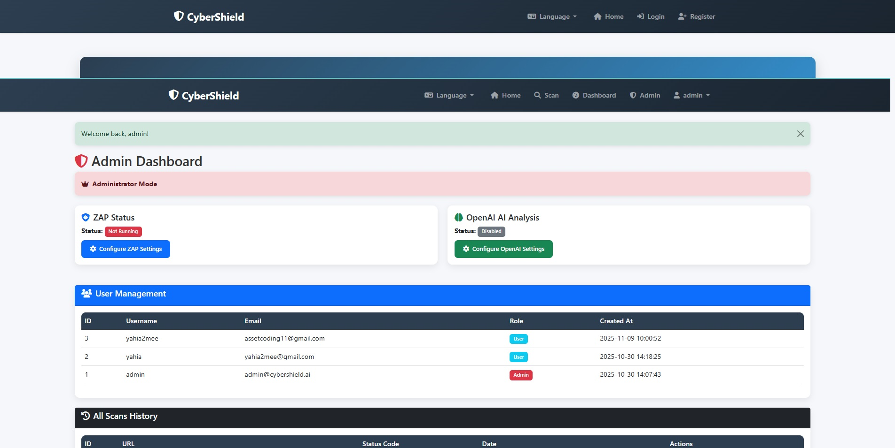

# CyberShieldAI

CyberShieldAI is a Flask-based web platform for practical web-application security assessment. It combines lightweight HTTP security checks, optional OWASP ZAP integration, AI-assisted analysis, PDF reporting, bilingual UI support, and administrative controls.



## Highlights

- User authentication and role-aware dashboards
- Fast HTTP checks for security headers and response behavior
- OWASP ZAP integration for deeper security scanning
- Optional OpenAI-assisted analysis of scan results
- Downloadable PDF security reports
- Arabic / English interface support
- Admin controls for users, scans, ZAP, and OpenAI settings
- SQLite-backed local persistence

## Tech Stack

- Python
- Flask
- Flask-Login
- SQLite
- OWASP ZAP
- OpenAI API
- ReportLab / FPDF
- scikit-learn
- pandas
- NumPy

## Installation

```bash
git clone https://github.com/yahiamee/CyberShieldAI.git
cd CyberShieldAI

python -m venv .venv
```

### Windows

```bash
.venv\Scripts\activate
pip install -r requirements.txt
set SECRET_KEY=replace-with-a-random-value-of-at-least-32-characters
python app.py
```

### Linux / macOS

```bash
source .venv/bin/activate
pip install -r requirements.txt
export SECRET_KEY=replace-with-a-random-value-of-at-least-32-characters
python app.py
```

By default, the application runs on:

```text
http://127.0.0.1:5000
```

## Project Structure

```text
app.py                     Application entry point
database.py                SQLite initialization and persistence
models/report_generator.py PDF report generation
templates/                 HTML templates
static/style.css           Main styling
reports/                   Generated scan reports
zap_manager.py             OWASP ZAP integration
openai_analyzer.py         OpenAI-assisted analysis
translations.py            Arabic / English localization
```

## Security Notes

For production deployments:

- Keep `SECRET_KEY` outside source control.
- Store API credentials in environment variables.
- Restrict OWASP ZAP access to trusted environments.
- Place the application behind a production web server and TLS.
- Review generated security findings before acting on automated recommendations.

## Contributors

- Eng. Yahia Hayder
- Mohammed Alomar
- Talal Alomar
- Mohammed Qahhat
- Sayyad Alhareth
- Mohammed Ali

## Disclaimer

Use security scanning tools only against systems you own or have explicit authorization to test.


## First-run configuration

Generate a session key with `python -c "import secrets; print(secrets.token_hex(32))"` and export it as `SECRET_KEY`. Startup rejects a missing or short key. `.env.example` documents the variables. The application reads shell environment variables and does not load `.env` automatically.

For a new database, set `CYBERSHIELD_ADMIN_USERNAME`, `CYBERSHIELD_ADMIN_EMAIL` and `CYBERSHIELD_ADMIN_PASSWORD` before the first start. Use a unique random password of at least 12 characters. Remove the bootstrap password from the environment after account creation. Existing users are preserved. There is no bundled account or default password. Change the old default administrator password in existing deployments through the application's account management.

The development server listens on loopback with debugging disabled. Use a production WSGI server and TLS for deployed environments. `HOST`, `PORT` and `FLASK_DEBUG` are explicit development overrides.

HTTP scans verify TLS certificates and report verification failures. HTTPS passive scans through ZAP require its trusted root CA exported as PEM and supplied through `ZAP_CA_BUNDLE`. Certificate errors are not retried with verification disabled.

Runtime databases, generated reports and Python caches are excluded from new commits. They remain in previous Git commits. Review previously published data and revoke any exposed service keys as appropriate. Use synthetic data for public examples.

## Local regression checks

Run `python -m unittest discover -s tests -v`. These checks cover administrator bootstrapping and existing account preservation without calling external services. Live ZAP and OpenAI integrations require separately configured services.

HTTPX is pinned to 0.27.2 to preserve compatibility with the existing OpenAI 1.3.0 client constructor. The local regression suite checks client initialization without making API requests.
